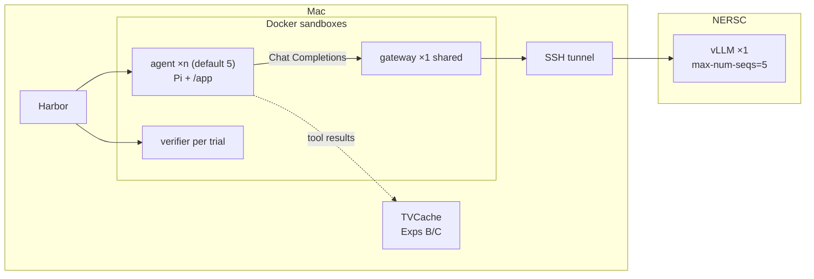

# CS5470 SYSML — Team 39: Parallel Tool-Value Cache

Run coding agents with **Harbor + Pi** against NERSC vLLM, characterize tool-calling workloads (Exp A), then add TVCache (sequential → parallel-aware) on the tool-execute path.

**Do not conflate:** **DeepSWE** / **TMax** = task suites Harbor loads · **Pi** / **Mini-SWE** = agent harnesses · **Harbor** = orchestrator. Exp A default is **Harbor + Pi**; Mini-SWE is isolation-only (cell B1).

## System diagram

**Agent** = **Pi** (`LoopbackPi` harness inside the agent sandbox; can emit several tool calls in one turn) **+** the LLM on NERSC (Exp A cells use `Qwen/Qwen3.5-9B` or `Qwen/Qwen3.8-27B` over **OpenAI Chat Completions**).

**Harbor** (Mac host process) builds/starts the Docker sandboxes below and feeds each trial `instruction.md`. The SSH tunnel is also a Mac host process. **TVCache** (`tvcache-rust` + `tvclient` on the Mac) caches tool results by trajectory prefix; Experiment A leaves it off (`none`).

Defaults: **pass@k = Harbor concurrency = vLLM `max-num-seqs` = 5**, so five rollouts of one task share one gateway and one vLLM (continuous batching). Monitor NERSC GPU memory; on OOM lower `SYSML_HARBOR_N` / `SYSML_MAX_NUM_SEQS` or use a 4B model. `gpu_memory_utilization` defaults to **0.80** to leave KV headroom for those five sequences.

| Sandbox | Image | How many live at once |
| --- | --- | --- |
| Model gateway | `sysml-model-gateway:refactor-check` (built once) | **1** per live NERSC serve / wave (shared) |
| Agent | task `environment/Dockerfile` (Pi runs **inside** here) | **× `SYSML_HARBOR_N`** (default **5**) |
| Verifier | task `tests/Dockerfile` | **per finished trial** (same image; new container each time) |
| — | NERSC vLLM (not a Mac sandbox) | **1** serve; up to **`SYSML_MAX_NUM_SEQS`** (default **5**) sequences |

Task **count** (3 vs 10) changes how many Harbor jobs you schedule over time; gateway/vLLM stay one shared pair. Concurrent rollouts + one TVCache server (Exps B/C) is the cross-rollout reuse setting.



## How a run works (`bash scripts/run_experiment.sh none`)

```text
run_experiment.sh none
  └─ run_harbor_wave.sh
       ├─ serve_up()     → NERSC: 1× GPU + vLLM (max-num-seqs=5)
       ├─ bridge_up()    → Mac: SSH tunnel + Chat Completions gateway container
       └─ run_task() × each needed task
            └─ harbor run -p variants/.../<task> -k 5 -n 5
                 ├─ agent image  (environment/Dockerfile) — Pi + LoopbackPi inside
                 └─ verifier image (tests/Dockerfile) — after each trial
```

| Step | Code | What it does |
| --- | --- | --- |
| Mode | `scripts/run_experiment.sh` | `none` → wave; `sequential` / `parallel` stub until TVCache is wired |
| Serve | `serve_up()` in `scripts/run_harbor_wave.sh` → `scripts/nersc_serve_model.sbatch` | `salloc --gpus-per-node=$SYSML_GPUS`, then `vllm serve --tensor-parallel-size $SYSML_TENSOR_PARALLEL_SIZE` |
| Bridge | `bridge_up()` in `scripts/run_harbor_wave.sh` | SSH forward + `sysml-model-gateway` (OpenAI Chat Completions proxy: `model.sock` → tunnel → vLLM) |
| Harbor | `run_task()` → `harbor run … -a …LoopbackPi` | Builds agent/verifier containers from the task folder; spawns up to **n** Pi agents |
| Pi | `parallel_tvcache/evaluation/loopback_pi.py` | Official Harbor Pi + in-sandbox model relay; tools stay in the agent container |
| TVCache | — | **Not started** for `none`. Exp B/C will share one Mac-side `tvcache-rust` across the concurrent rollouts |

**GPUs vs concurrency:** Five rollouts are five Chat Completions clients to one vLLM (`--max-num-seqs 5`). At **8K** context, **1×A100** is enough (cell A0). At **256K×5**, KV needs **tensor parallel** across multiple GPUs (cell A1: 4×A100, `--tensor-parallel-size 4`) — not a second replica.

**`bridge_up` in one line:** yes — it is our Mac-side Chat Completions gateway (plus the SSH tunnel). Agents never talk to NERSC directly; they hit the Unix socket → gateway → tunnel → vLLM `/v1/chat/completions`.

Key files in order: `run_experiment.sh` → `run_harbor_wave.sh` → `nersc_serve_model.sbatch` → `loopback_pi.py` → `inference/model_transport.py` → task folder under `variants/…/tasks/<id>/`.

## Layout

```text
README.md                 teammate entrypoint
artifacts/
  expA-traces-A0-A2.zip   curated Pi sessions + summaries (~5 MB; not full jobs/)
docs/
  project_assignment.pdf
  workload_characterization_report.md      Exp A cells A0–T2 (one table; extend by row)
  parallel_prompt_stress_report.md         forced-parallel Multitool stress (not natural Exp A)
parallel_tvcache/         Harbor/Pi adapters, model transport, measurement, cache prototype
variants/
  deep-swe-setup/         DeepSWE setup-in-instruction tasks (A0–A3b, B1)
  tmax-easy/              TMax short+bash-only tasks (T1–T2 pipeline proof)
configs/                  example.env · experiment-tasks*.txt · models/
scripts/
  setup_repositories.sh       clone vendor deps
  prepare_task.py             rebuild a task variant under variants/
  prepare_parallel_stress.py  prepend max-parallel instruction (stress only; not Exp A)
  run_mlx_parallel_stress.sh  local MLX forced-parallel stress wave
  run_experiment.sh           mode = none|sequential|parallel|all; add --parallel-test for stress
  run_harbor_wave.sh          NERSC + Harbor (Exp A default; sequential → TvcacheLoopbackPi)
  tvcache_server.sh           start/stop paper tvcache-rust (:7878)
  tvcache_tool_gateway.sh     start/stop host tool gateway (Unix sock)
  tvcache_client_smoke.py     insert/find smoke against tvcache-rust
  analyze_tvcache_metrics.py  summarize Exp B hit/miss JSONL
  nersc_serve_model.sbatch    vLLM on NERSC (reads SYSML_MAX_NUM_SEQS, etc.)
  monitor_nersc_gpu.sh        poll nvidia-smi on the live alloc (GPU memory)
  monitor_vllm_metrics.sh     poll vLLM /metrics (KV% / Running / Waiting) via tunnel
  download_qwen3_5_9b.py      optional: pull weights onto NERSC
  analyze_characterization_wave.sh   parallel-turn fraction for a job prefix
  check_trial.py              post-trial check used by the wave
  run_one.sh                  optional local smoke only (k=1 n=1; not the experiment path)
  demo_cache.py               unwired in-memory cache demo
vendor/                   deep-swe, tvcache-rust, tvclient (gitignored)
jobs/, results/           local run evidence (gitignored)
```

### What a Harbor task is

A **task** is a folder Harbor loads (DeepSWE *or* TMax — same layout), mainly:

| Path | Role |
| --- | --- |
| `instruction.md` | User message the harness shows the model |
| `environment/Dockerfile` | Builds the agent sandbox image |
| `tests/` | Separate verifier image + grader (agent never sees this while solving) |
| `solution/` | Reference fix when present (not shown to the agent) |

At run time the agent only gets **`instruction.md` + a live container**. Harbor builds that container from the Dockerfile; it does not paste the Dockerfile, tests, or solution into the chat. Default harness is **Pi** (`LoopbackPi`); set `SYSML_HARBOR_AGENT=mini-swe-agent` only for Mini-SWE isolation.

**Stock DeepSWE:** the Dockerfile already clones and installs, so `/app` is ready when the agent starts and setup never shows up as tool calls.

**Our DeepSWE variants** (`variants/deep-swe-setup/tasks/<id>/`): copy the official task, keep `tests/` the same, then (1) clear `/app` in the agent image and (2) prepend clone/install steps to `instruction.md`. Build more with `scripts/prepare_task.py <task_id> --setup-as-agent-actions`.

**TMax easy** (`variants/tmax-easy/tasks/<id>/`): short+bash-only extracts used for **T1/T2** to prove the Harbor+Pi+NERSC path when DeepSWE stays reward 0 (task hardness). See `variants/tmax-easy/README.md`.

## Install

Shared by every experiment:

```bash
uv venv && source .venv/bin/activate          # create + enter Python venv
uv pip install -e '.[dev]'                    # install this package + test deps
uv pip install -e vendor/tvclient             # paper TVCache Python client (Exp B)
uv tool install harbor                        # install Harbor CLI
bash scripts/setup_repositories.sh            # clone vendor/deep-swe, tvcache-rust, tvclient
cp configs/example.env .env                   # local MODEL knobs (gitignored)
python -m pytest -q                           # sanity-check unit tests

# Open the Docker Desktop app, then build the Mac-side model gateway once:
docker build -f configs/model-gateway.Dockerfile -t sysml-model-gateway:refactor-check .

# Exp B smoke (no Harbor): build+start paper TVCache server, insert/find round-trip
bash scripts/tvcache_server.sh start
PYTHONPATH=vendor/tvclient:. python scripts/tvcache_client_smoke.py
bash scripts/tvcache_tool_gateway.sh start    # Unix sock → tvclient
bash scripts/tvcache_tool_gateway.sh stop
bash scripts/tvcache_server.sh stop
```

## Project status — 2026-11-05

| Experiment | Mode flag | What we measure | Status |
| --- | --- | --- | --- |
| **A** | `none` | Reward; parallel-turn fraction; cross-rollout TCG prefix | **Harbor + Pi** throughout (except B1 Mini-SWE). DeepSWE tasks ×9B/27B: reward 0 (task hard). **Pipeline proven** on **TMax** short tasks ×27B×Pi: **T1 5/5**, **T2 40/40** reward 1.0 on 8 valid tasks — `docs/workload_characterization_report.md` |
| **B** | `sequential` | Sequential TVCache hit rate / tool-wait (shared TCG across concurrent pass@k) | **Wired** — `tvcache-rust` + host tool gateway + `TvcacheLoopbackPi`; run matched TMax-8 via `configs/models/qwen3.8-27b-tmax-easy8-tvcache-seq.env.example`. Table 2 Exp B row still TBD until full wave metrics. |
| **C** | `parallel` | Parallel-aware TVCache (within-turn N>1) | Natural parallel >0 on 27B×Pi (DeepSWE-tasks ~5%, TMax ~15–24%); forced Multitool stress separate (`docs/parallel_prompt_stress_report.md`) |

One runner; pick the mode you want (A-only, B-only, C-only, or `all`). It does **not** re-run other modes unless you pass `all`.

```bash
bash scripts/run_experiment.sh none         # Experiment A only
bash scripts/run_experiment.sh sequential   # Experiment B (TVCache sequential)
bash scripts/run_experiment.sh parallel     # Experiment C only (stub today)
bash scripts/run_experiment.sh all          # A, then B, then C
```

**Exp B run (matched contract):**

```bash
set -a && source configs/models/qwen3.8-27b-tmax-easy8-tvcache-seq.env.example && set +a
export SYSML_NERSC_USER=<user>
export SYSML_REMOTE_ROOT=/pscratch/sd/<letter>/<user>/sysml_parallel_tvcache
bash scripts/run_experiment.sh sequential
# metrics: results/characterization/$SYSML_JOB_PREFIX/tvcache-metrics.jsonl
python scripts/analyze_tvcache_metrics.py results/characterization/$SYSML_JOB_PREFIX/tvcache-metrics.jsonl
```

### Handout tables (filled from T2 where possible)

#### Matched run contract (Table 1 TMax + Table 2 all rows)

Use **exactly** this stack for no-cache baseline and for Exp B/C cache rows — only the cache mode may change:

| Knob | Required value |
| --- | --- |
| Orchestrator | **Harbor** (Mac Docker) |
| Agent / harness | **Pi** — Exp A no-cache: `LoopbackPi`; Exp B: `TvcacheLoopbackPi` (same Pi LLM loop; tools via TVCache gateway). **Not** Mini-SWE / Multitool |
| Model | **`Qwen/Qwen3.8-27B`** |
| Tasks | **These 8 ids** only (`configs/experiment-tasks-tmax-easy8.txt` → `variants/tmax-easy/tasks/<id>/`) |
| Pass@k / Harbor concurrency / vLLM seqs | **`pass@5` · `-n 5` · `--max-num-seqs 5`** (`SYSML_PASS_K=SYSML_HARBOR_N=SYSML_MAX_NUM_SEQS=5`) |
| Context / turns / completion / thinking | **256K** (`SYSML_MAX_MODEL_LEN=SYSML_CONTEXT_WINDOW=262144`) · **`SYSML_MAX_TURNS=100`** · **`SYSML_MAX_TOKENS=32768`** · **`SYSML_THINKING=xhigh`** |
| GPUs | **TP=4** / 4×GPU (`SYSML_GPUS=SYSML_TENSOR_PARALLEL_SIZE=4`) |
| No-cache baseline cell | T2 prefix `tmax-qwen38-27b-easy10-t100-xh` (mode `none`); env template `configs/models/qwen3.8-27b-tmax-easy10-pi.env.example` with `SYSML_TASK_LIST=configs/experiment-tasks-tmax-easy8.txt` |

**The 8 task ids:**

```text
task_004783_a0ba89ed
task_004205_b4f9a6a8
task_004019_52b6d9d0
task_002284_acbf44a1
task_004822_edd3263f
task_004636_913540cc
task_004810_73ab18e6
task_009308_8d615af9
```

Do **not** include `task_001033_d7fd9ed7` (env-start timeout) or `task_009942_0ca9b627` (agent timeout) from the attempted easy10 list. Cell detail: `docs/workload_characterization_report.md`. DeepSWE Table 1 rows use Exp A **A3** (clack ×27B×Pi), not this TMax set.

#### Table 1 — Workload characterization

| Benchmark | Tool type | Turns with >1 tool call (%) | Calls-per-turn CDF (P(≤k)) |
| --- | --- | ---: | --- |
| **TMax** (T2, 8 tasks above, 40 sessions / 267 turns) | All tools | **15.0%** (40/267) | ≤0: 0.15 · ≤1: 0.85 · ≤2: 0.97 · ≤3: 0.99 · ≤4: 1.00 |
| TMax | `bash` | **2.6%** (7/267) | ≤0: 0.28 · ≤1: 0.97 · ≤2: 1.00 |
| TMax | `read` | **3.4%** (9/267) | ≤0: 0.88 · ≤1: 0.97 · ≤2: 0.98 · ≤3: 0.99 · ≤4: 1.00 |
| TMax | `edit` | **0%** (0/267) | ≤0: 0.92 · ≤1: 1.00 |
| TMax | `write` | **0%** (0/267) | ≤0: 0.97 · ≤1: 1.00 |
| DeepSWE (A3 clack ×27B×Pi) | All tools | **4.8%** (19/397) | ≤0: 0.01 · ≤1: 0.95 · ≤2: 1.00 |
| DeepSWE (A3) | `bash` / `read` / `edit` / `write` | 2.3% / 1.0% / 0% / 0% | see `results/characterization/char-qwen38-27b-clack-t250-xh/parallel_summary.json` |

CDF = fraction of assistant turns with **at most** *k* model-emitted tool calls (includes zero-call turns). This is **emission** parallelism, not measured wall-clock overlap.

#### Table 2 — Cache comparison

| Configuration | Per-call hit rate (%) | Per-turn hit rate (%) | Tool-wait time saved (%) | pass@1 | pass@5 |
| --- | ---: | ---: | ---: | ---: | ---: |
| **No cache reuse** (Exp A `none`, matched contract above) | N/A | N/A | **0** (reference) | **8/8 (100%)** | **8/8 (100%)** |
| Existing single-call TVCache (Exp B) | TBD (run wave) | TBD | TBD | TBD | TBD |
| Parallel-aware TVCache (Exp C) | TBD | TBD | TBD | TBD | TBD |

**pass@5:** task solved if any of the 5 concurrent trials has verifier reward 1.0 → **8/8** (all 40 graded trials reward 1.0).  
**pass@1:** first trial per task among the k=5 batch (earliest `result.json` mtime among the five Harbor trial dirs) → also **8/8** (every trial succeeded).  
Exp B wiring is in-tree (`bash scripts/run_experiment.sh sequential`); fill hit-rate / tool-wait from `tvcache-metrics.jsonl` after the matched TMax-8 wave. Exp C still stub.

### Experiment A — primary completed cell (2026-11-01)

| Item | Value |
| --- | --- |
| Tasks | **10** setup variants (`configs/experiment-tasks.txt` → `variants/deep-swe-setup/tasks/`) |
| Model / harness | `Qwen/Qwen3.5-9B` · Harbor Pi 1.4 · `LoopbackPi` |
| Budget | `max_turns=8`, thinking off, mode `none`, pass@5 |
| Concurrency | Harbor **`-k 5 -n 5`**, vLLM **`--max-num-seqs 5`**, `gpu_memory_utilization=0.80` |
| Job prefix | `char-setup-10t-k5` |
| GPU | A100-80GB · steady ~65 GiB used · **no OOM** at seqs=5 |
| Result | **0 / 199 = 0.00%** parallel · **50/50** sessions · reward **0** all trials · bash-dominated sequential turns |
| Write-up | **`docs/workload_characterization_report.md`** (all cells in one table) |
| Artifacts | `results/characterization/char-setup-10t-k5/` · `jobs/char-setup-10t-k5-*/` |

Later cells (A1–A3 DeepSWE × Pi, B1 Mini-SWE, **T1–T2 TMax × Pi**): same report table. DeepSWE stays reward 0; TMax ×27B×Pi unlocks reward 1.0. Prefer **TP=2** for 9B / **TP=4** for 27B. Env examples under `configs/models/`.

```bash
# TP2 / thinking pilot (or pick another configs/models/*.env.example). Use YOUR pscratch root — see Reproduce.
export SYSML_NERSC_USER=<user>
export SYSML_REMOTE_ROOT=/pscratch/sd/<letter>/<user>/sysml_parallel_tvcache
export SYSML_SSH_HOST=perlmutter SYSML_SLURM_ACCOUNT=m4999
set -a && source configs/models/qwen3.5-9b-kvpack-tp2-think-high.env.example && set +a
export SYSML_TASK_PARALLEL=1   # Mac Docker: avoid 2×n=5 bind/subnet races
export DOCKER_BUILDKIT=0 COMPOSE_DOCKER_CLI_BUILD=0
bash scripts/run_experiment.sh none   # prefer Terminal.app / screen
```

### Team status / parallel work

| Owner track | Status |
| --- | --- |
| Exp A (`none`) | Cells through **T2** — DeepSWE **tasks** stay reward 0; **same Pi harness** + TMax tasks → reward 1.0 (pipeline OK). Mini-SWE = B1 only |
| Exp B sequential TVCache | **Wired** — run `qwen3.8-27b-tmax-easy8-tvcache-seq.env.example`; coordinate with Saifei so we don’t duplicate the matched TMax-8 wave |
| Exp C | Natural parallel already >0 on 27B×Pi; forced Multitool stress optional — see stress report |

### Experiment A — historical 3-task cell (2026-10-30)

Earlier baseline **before** concurrent defaults: prefix `char-setup-9b-t8v2`, 3 tasks, Harbor `-n 1` / `max-num-seqs 1`, **0 / 55 = 0.00%** parallel. Same qualitative shape; do not conflate with `char-setup-10t-k5`.

**A0 re-run knobs:** `harbor -k 5 -n 5`, vLLM `--max-num-seqs 5`, 1 GPU, 8K (see `qwen3.5-9b-pilot.env.example`). Host **must** have `OPENAI_BASE_URL=http://127.0.0.1:18081/v1` + `OPENAI_API_KEY=EMPTY` (set inside `run_harbor_wave.sh`).

## Reproduce experiments

**Two different goals:**

| Goal | What to do |
| --- | --- |
| Re-analyze published Exp A numbers | Unzip `artifacts/expA-traces-A0-A2.zip` into this repo root → `bash scripts/analyze_characterization_wave.sh <prefix>` (see report for prefixes) |
| Re-run the same *kind* of Exp A wave | Mac **Install** above + **your own** NERSC `SYSML_REMOTE_ROOT` below (traces will not match bit-for-bit) |

**`SYSML_REMOTE_ROOT` is per teammate** — use `/pscratch/sd/<first-letter-of-user>/<user>/sysml_parallel_tvcache` (or any writable pscratch dir). Do **not** hard-code someone else’s path. Harbor/Pi stay on the Mac; only vLLM + weights live under that root.

One-time on NERSC (after MFA), from a login node with that root exported:

```bash
# on perlmutter — create YOUR root once
export SYSML_REMOTE_ROOT=/pscratch/sd/<letter>/<user>/sysml_parallel_tvcache
mkdir -p "$SYSML_REMOTE_ROOT"/{hf-cache,secrets,logs}
# venv with vLLM (name must be env-model — sbatch expects it):
#   cd "$SYSML_REMOTE_ROOT" && python -m venv env-model && source env-model/bin/activate && pip install 'vllm>=0.10' ...
# weights into $SYSML_REMOTE_ROOT/hf-cache (or run scripts/download_qwen3_5_9b.py with REMOTE_ROOT set, on a node that can reach HF)
# API key file the serve reads:
#   openssl rand -hex 24 > "$SYSML_REMOTE_ROOT/secrets/model-api-key" && chmod 600 "$SYSML_REMOTE_ROOT/secrets/model-api-key"
```

Wave will `scp` `nersc_serve_model.sbatch` into that root each run. Setup-task variants are already under `variants/deep-swe-setup/tasks/` in git.

Placeholders below are **shell env vars** — replace angle brackets, then `export`.

| Variable | Set to |
| --- | --- |
| `SYSML_NERSC_USER` | **your** NERSC username |
| `SYSML_REMOTE_ROOT` | **your** pscratch project dir (pattern above) |
| `SYSML_SSH_HOST` | usually `perlmutter` |
| `SYSML_SLURM_ACCOUNT` | `m4999` |
| `SYSML_JOB_PREFIX` | unique wave name, e.g. `char-setup-10t-k5-rerun` |
| `SYSML_TUNNEL_LOCAL_PORT` | free local port, e.g. `18086` |
| `SYSML_PASS_K` / `SYSML_HARBOR_N` / `SYSML_MAX_NUM_SEQS` | usually all **5** |
| `SYSML_MAX_MODEL_LEN` / `SYSML_CONTEXT_WINDOW` | A0 **8192**; A1/A2 **262144** |
| `SYSML_MAX_TURNS` | A0 **8**; A1 **100**; A2 pilots **250–500** |
| `SYSML_GPUS` / `SYSML_TENSOR_PARALLEL_SIZE` | A0 **1**; A1 **4**; preferred A2+ **2** |
| `SYSML_SLURM_QOS` | `shared_interactive` (1 GPU) or `interactive` (multi-GPU) |
| `SYSML_GPU_MEMORY_UTILIZATION` | A0 **0.80**; multi-GPU examples **0.90** |
| `SYSML_ATTACH_JOB` / `SYSML_ATTACH_NODE` | optional: reuse a live READY serve after a Mac runner death |

Or source a cell env: `set -a && source configs/models/<cell>.env.example && set +a`, then still export **your** `SYSML_NERSC_USER` + `SYSML_REMOTE_ROOT`.

`run_harbor_wave.sh` sets `OPENAI_API_KEY=EMPTY` and `OPENAI_BASE_URL=http://127.0.0.1:18081/v1` for Harbor Pi. **Do not omit** if you wrap `harbor run` yourself.

### 1. Connect to NERSC (MFA)

```bash
sshproxy -u <user> -f    # browser Iris / federated login + OTP
ssh perlmutter           # optional check, then exit
```

### 2. Export env + run (Mac)

```bash
export SYSML_NERSC_USER=<user>
export SYSML_REMOTE_ROOT=/pscratch/sd/<letter>/<user>/sysml_parallel_tvcache   # YOUR root
export SYSML_SSH_HOST=perlmutter
export SYSML_SLURM_ACCOUNT=m4999
# A0 baseline (or: source configs/models/qwen3.5-9b-kvpack-tp2-think-high.env.example for TP2/thinking)
export SYSML_JOB_PREFIX=char-setup-10t-k5-rerun
export SYSML_TUNNEL_LOCAL_PORT=18086
export SYSML_PASS_K=5 SYSML_HARBOR_N=5 SYSML_MAX_NUM_SEQS=5
export SYSML_GPU_MEMORY_UTILIZATION=0.80
export SYSML_TASKS_PER_ALLOC=2
export DOCKER_BUILDKIT=0 COMPOSE_DOCKER_CLI_BUILD=0

# Prefer Terminal.app / screen (Cursor-shell nohup can reap Harbor):
screen -dmS char10 bash scripts/run_experiment.sh none
```

When finished: `ssh perlmutter scancel -u <user> -n sysml-char-9b`

### 3. Analyze

```bash
bash scripts/analyze_characterization_wave.sh "$SYSML_JOB_PREFIX"
# → results/characterization/<prefix>/parallel_summary.json (+ gpu-monitor.log if present)
```

## References

- Handout PDF: `docs/project_assignment.pdf`
- Exp A report: `docs/workload_characterization_report.md`
- https://github.com/abhivijay96/tvcache-rust · https://github.com/abhivijay96/tvclient
- https://github.com/harbor-framework/harbor · https://github.com/earendil-works/pi · https://github.com/datacurve-ai/deep-swe
